<picture><source media="(max-width: 767px)" srcset="./assets/m/banner.svg"></picture>

  
  &nbsp;
  

<picture><source media="(max-width: 767px)" srcset="./assets/m/nav-about.svg"></picture>

<a href="https://www.linkedin.com/in/kamlesh-choudhary21/"><picture><source media="(max-width: 767px)" srcset="./assets/m/about.svg"></picture></a>

<picture><source media="(max-width: 767px)" srcset="./assets/m/nav-stack.svg"></picture>

<picture><source media="(max-width: 767px)" srcset="./assets/m/stack.svg"></picture>

<picture><source media="(max-width: 767px)" srcset="./assets/m/nav-projects.svg"></picture>

  <a href="https://github.com/JustKamlesH21/Salvage_Agent"><picture><source media="(max-width: 767px)" srcset="./assets/m/card-salvage.svg"></picture></a>
  <a href="https://github.com/JustKamlesH21/driver-drowsiness-faint-detection"><picture><source media="(max-width: 767px)" srcset="./assets/m/card-drowsiness.svg"></picture></a>

  <a href="https://github.com/JustKamlesH21/Hybrid_CNN_Sysmon_using_CTI"><picture><source media="(max-width: 767px)" srcset="./assets/m/card-sysmon.svg"></picture></a>
  <a href="https://github.com/JustKamlesH21/Insurance_Agent"><picture><source media="(max-width: 767px)" srcset="./assets/m/card-fnol.svg"></picture></a>

  <a href="https://github.com/JustKamlesH21/template-detector"><picture><source media="(max-width: 767px)" srcset="./assets/m/card-template.svg"></picture></a>
  <a href="https://github.com/JustKamlesH21/oracle-vm-grabber"><picture><source media="(max-width: 767px)" srcset="./assets/m/card-oracle.svg"></picture></a>

<picture><source media="(max-width: 767px)" srcset="./assets/m/internship.svg"></picture>

<picture><source media="(max-width: 767px)" srcset="./assets/m/nav-log.svg"></picture>

<picture><source media="(max-width: 767px)" srcset="./assets/m/achievements.svg"></picture>

<picture><source media="(max-width: 767px)" srcset="./assets/m/research.svg">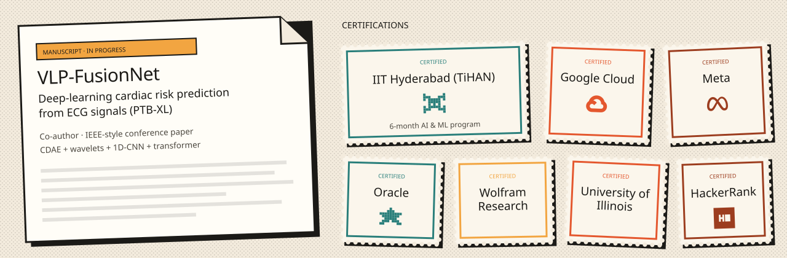</picture>

<picture><source media="(max-width: 767px)" srcset="./assets/m/nav-stats.svg"></picture>

<picture><source media="(max-width: 767px)" srcset="./assets/m/stats.svg"></picture>

<a href="https://www.linkedin.com/in/kamlesh-choudhary21/"><picture><source media="(max-width: 767px)" srcset="./assets/m/footer.svg"></picture></a>
